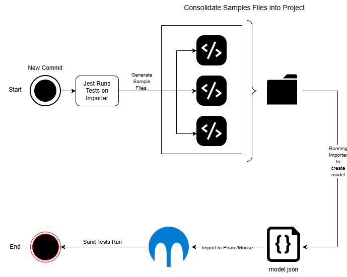
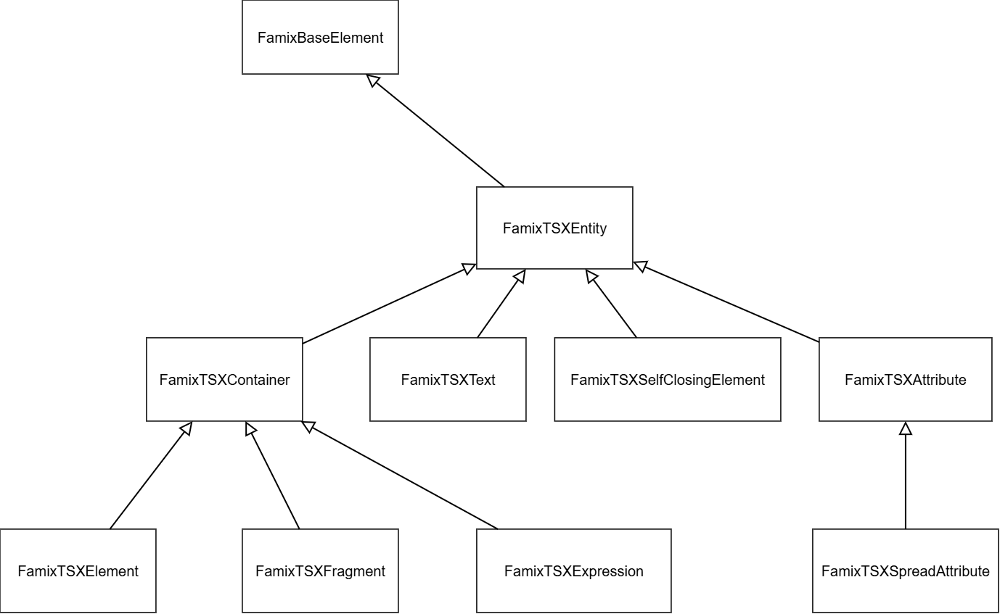

Every time [Moose](https://github.com/moosetechnology) evolves, the tools built on top of it have to evolve as well. So this summer, during my Mitacs Globalink internship at ÉTS Montréal under the supervision of Professor Christopher Fuhrman, I migrated the [FamixTypeScript](https://github.com/fuhrmanator/FamixTypeScript) metamodel and its companion importer [`ts2famix`](https://github.com/fuhrmanator/FamixTypeScriptImporter) to the latest version of Moose, Moose 13, while also setting up a CI/CD pipeline in Github Actions that automates tests across both environments, providing end-to-end validation for the changes.

## Assumptions

This post assumes familiarity with [`ts2famix`](../typescript-in-moose/) and a basic understanding of the two tech stacks involved: TypeScript and Pharo Smalltalk/Moose. The modeling of generics and concretizations builds on the work described in Clotilde Toullec's post [Parametrics next generation](https://modularmoose.org/blog/2025-05-07-parametrics-next-generation/).

## Automating End-to-End Testing

Analyzing a TypeScript project with `ts2famix` involves two steps. First, the importer parses the project and generates a `model.json` file. This file is then loaded into a Pharo environment, where the FamixTypeScript metamodel is used to represent the project.

Previously, these two steps were tested independently. The importer was tested using Jest, while the Pharo tests were run manually after importing the model into the Moose environment. Although each step worked on its own, this did not guarantee that the generated model could be successfully imported into Pharo or that it contained all the expected entities. Discrepancies between the importer and the metamodel could go undetected.

To address this, I implemented a CI/CD pipeline in GitHub Actions that automates testing across both environments. Whenever new code is pushed to the repository, the pipeline runs the following steps:

1. **Run the Jest test suite:** The importer's Jest tests verify that different aspects of TypeScript syntax are correctly captured in the generated model.

2. **Generate a sample project:** The pipeline combines the code snippets used in the test files into a sample project.

3. **Generate the model:** The importer processes this sample project and generates a `model.json` file.

4. **Import the model into Pharo:** The generated model is loaded into the Pharo environment containing the FamixTypeScript metamodel.

5. **Run the Pharo tests:** The Pharo test suite validates that the expected entities are successfully imported into the model.

{.lightbox}

## Migrating the FamixTypeScript Metamodel and ts2famix Importer to Moose 13

`FamixTypeScript` is built on top of the Moose ecosystem. When Moose was updated from version 12 to 13, changes to the foundational Moose entities meant that the existing metamodel was no longer compatible with the new version. For this reason, the FamixTypeScript metamodel, and subsequently the importer, had to be updated.

### Introducing Entity Typing

Moose 13 introduced `EntityTyping`, an association that replaces the direct relationship between a typed entity and its type. This change brought type relationships in line with the latest Moose structure and provides a more flexible way to represent TypeScript types.

The new structure is shown in the following diagram:

](https://modularmoose.org/_astro/uml-entity-typing.DDPWOCX4_Z1xnFi4.webp){.lightbox}

The following FamixTypeScript entities were updated to use the new `EntityTyping` structure:

- `Function`
- `ParametricFunction`
- `ArrowFunction`
- `ParametricArrowFunction`
- `Method`
- `ParametricMethod`
- `Accessor`
- `EnumValue`
- `Parameter`
- `Property`
- `Variable`

### Restructuring Concretizations

In object-oriented programming, generic entities can be declared using type parameters and then used with specific types. For example, consider the following TypeScript code:

```typescript
class Box<T> {
    value: T;
}

const box = new Box<string>();
```

Here, `Box` is a generic class with a type parameter `T`. When `Box<string>` is instantiated, `T` is associated with the concrete type `string`.

The Famix model needs to represent both the generic entity and its usages separately. Previously, representing a concretization involved creating a duplicate of the generic entity and linking the duplicate directly to the original. The updated Moose metamodel introduces a dedicated `Concretization` entity to represent this relationship explicitly.

A concretization is modeled as a three-way association connecting a type parameter, the concrete type argument that replaces it, and the parametric association that triggered the concretization.

The diagram below illustrates the new structure.

](https://modularmoose.org/_astro/uml-parametric-association.fXCQF5U9_6Lk40.webp){.lightbox}

### Parametric Associations

Alongside the changes to concretizations, the new metamodel introduced five parametric associations. These associations represent relationships in which a generic entity is used with concrete types.

#### Parametric Implementation

Parametric implementation represents a class implementing a generic interface. For example:

```typescript
interface Repository<T> {}

class UserRepository implements Repository<string> {}
```

Here, `UserRepository` implements `Repository<string>`.

#### Parametric Inheritance

Parametric inheritance represents inheritance from a generic type. For example:

```typescript
class Animal<T> {}

class Dog extends Animal<string> {}
```

Here, `Dog` inherits from the concretized type `Animal<string>`.

#### Parametric Invocation

Parametric invocation represents a call to a generic function or method with concrete type arguments. For example:

```typescript
function identity<T>(value: T): T {
    return value;
}

identity<number>(42);
```

Here, the invocation supplies `number` as the type argument for `T`.

#### Parametric Reference

A parametric reference occurs when a generic entity is used in other places in code. For example:

```typescript
class Box<T> {
  value!: T;
}

function createStringBox() {
  const StringBox = Box<string>;
}
```

Here, the function `createStringBox` refers to the generic class `Box` with the type argument `string`. The concretization maps the type parameter `T` to `string`.

#### Parametric Entity Typing

Parametric entity typing represents a typing relationship involving a parameterized type, extending the `EntityTyping` association with support for concretizations.

For example:

```typescript
class Box<T> {
    value: T;
}

let box: Box<string>;
```

Here, the parametric entity typing declares the type of `box` as `Box`, and its concretization maps the type parameter `T` to the concrete type `string`.

](https://modularmoose.org/_astro/uml-new-parametrics-mm.BTiU1iMv_1BpMeh.webp){.lightbox}

### Progress in the Importer and npm Release

All of the associations discussed above have been incorporated into the metamodel, and their APIs have been added to the importer. Among these, Entity Typing, Parametric Entity Typing, Parametric Invocation, and Parametric Inheritance are implemented in the importer's logic and are now visible in the generated model.

Along with these changes, the way the importer resolves types was also improved. Previously, whenever an entity was given a type, the importer created a new generic `Type` entity and pointed the typing at it, even when the specific entity for that type, such as a `Class`, `Interface`, or `Enum`, already existed in the model. This resulted in duplicates and disconnected type entities. Now, the importer first checks whether the specific type already exists in the model and reuses it if it does. Otherwise, it creates that specific type instead of falling back to the abstract `Type`. For example:

```typescript
class User {}

let user: User;
```

Previously, `user` would have been typed by a new `Type` entity named `User`. Now, its typing points directly to the existing `User` class.

Among other things, Parametric Reference has not been implemented yet. It builds on Reference, which exists in the model but is not yet created by the importer's parsing logic, so the parametric counterpart will be added once References are in place.

Parametric Implementation is also not implemented. The importer currently treats implementation and extension as the same kind of relationship. After discussing this with Professor Fuhrman, we concluded that the two may be too similar in TypeScript to need separate associations, so implementation is currently handled through inheritance.

In line with these changes, many of the tests in both the importer and the metamodel have been updated to reflect the new structures. A new version of `ts2famix` including these changes has been published on npm. The latest version at the time of writing is [v3.3.0](https://www.npmjs.com/package/ts2famix).

## Adding TSX Support and Planning a TypeScript Famix Extension

Another goal of my project was to add TSX support to the importer. `ts2famix` is built on top of [`ts-morph`](https://www.npmjs.com/package/ts-morph), and while experimenting with it, we found that it already supports JSX syntax. This means that `ts2famix` can be extended to handle TSX using the same tools the importer is already built on.

Initially, we planned to incorporate the TSX extension into the `FamixTypeScript` metamodel itself. After further discussion, we concluded that a separate metamodel built on top of `FamixTypeScript` might be a better approach. A draft of this metamodel, covering the entities specific to TSX, has been modeled and is shown below:

{.lightbox}

### TSX Entities

Each entity described in the TSX metamodel corresponds to a JSX node inside `ts-morph`. They are described below, from more general ones to more specific.

#### FamixTSXEntity

`FamixTSXEntity` is the abstract root of the TSX metamodel. It extends `FamixBaseElement`, so every TSX entity fits into the existing Famix infrastructure. It is never created directly; it only provides a base for all the entities below.

#### FamixTSXContainer

`FamixTSXContainer` is an abstract entity for those TSX entities that can contain other TSX entities.

#### FamixTSXElement

`FamixTSXElement` represents a JSX element with an opening and a closing tag. It can contain text, expressions, and other elements as children.

```jsx
<div className="card">
  <h1>Title</h1>
</div>
```

Here, both `<div>` and `<h1>` are `FamixTSXElement`s.

#### FamixTSXFragment

`FamixTSXFragment` represents a JSX fragment, which acts as a wrapper to group children without adding an extra element to the output.

```jsx
<>
  <h1>Title</h1>
</>
```

The `<>...</>` wrapper is a `FamixTSXFragment`.

#### FamixTSXExpression

`FamixTSXExpression` represents a JavaScript expression inside JSX between curly braces.

```jsx
<ul>
  {items.map(item => <li>{item.name}</li>)}
</ul>
```

Both `{items.map(...)}` and `{item.name}` are `FamixTSXExpression`.

#### FamixTSXText

`FamixTSXText` represents the plain text between JSX tags.

```jsx
<p>Hello, world!</p>
```

The text `Hello, world!` is a `FamixTSXText`.

#### FamixTSXSelfClosingElement

`FamixTSXSelfClosingElement` represents a JSX element that closes itself and has no children.

```jsx

<UserCard user={user} />
```

Both `` and `<UserCard />` are `FamixTSXSelfClosingElement`.

#### FamixTSXAttribute

`FamixTSXAttribute` represents a single named attribute (also called a prop) on a JSX element. Its value can be a string literal or an expression.

```jsx
<button type="submit" onClick={handleClick}>Save</button>
```

Here, `type="submit"` and `onClick={handleClick}` are both `FamixTSXAttribute` of the `<button>` element.

#### FamixTSXSpreadAttribute

`FamixTSXSpreadAttribute` represents a spread of an object's properties as attributes. It is still an attribute, but its purpose is to apply many attributes at once.

```jsx
<Input {...inputProps} disabled />
```

Here, `{...inputProps}` is a `FamixTSXSpreadAttribute`.

The following table maps each TSX entity to its `ts-morph` counterpart.

| Famix TSX entity | ts-morph counterpart |
|---|---|
| `FamixTSXEntity` | No direct counterpart (abstract) |
| `FamixTSXContainer` | No direct counterpart (abstract) |
| `FamixTSXElement` | `JsxElement` |
| `FamixTSXSelfClosingElement` | `JsxSelfClosingElement` |
| `FamixTSXFragment` | `JsxFragment` |
| `FamixTSXExpression` | `JsxExpression` |
| `FamixTSXText` | `JsxText` |
| `FamixTSXAttribute` | `JsxAttribute` |
| `FamixTSXSpreadAttribute` | `JsxSpreadAttribute` |

Right now the importer is able to accept `.tsx` files, but capturing TSX specific entities are yet to be added into the importer.

## AI Assistance

AI tools were valuable throughout this project. The biggest challenge during development was adding the new concretization structure, a change that touched many entities and many parts of the codebase. With the help of AI, I was able to determine the full scope of this change and implement it more quickly.

AI also helped me understand the structure of the metamodel and the importer's parsing logic, which made it easier to implement the parametric associations and the Entity Typing changes. It made repetitive changes easier, and helped me with options when making design decisions.

## Where to Go From Here

There are lots of different directions this project could take. The most immediate would be to complete the parametric associations and their related entities, starting with References, on which Parametric Reference depends. After that, a separate Pharo metamodel for TSX, built on top of `FamixTypeScript`, can be created and integrated into the importer. The Moose post on [connecting and extending metamodels](https://modularmoose.org/blog/2021-05-15-connecting-meta-models/) could be of great help for this. Finally, the importer itself could benefit from a refactor. The `EntityDictionary` has many separate maps for different kinds of entities, several of which are rarely used. A redesign of these global maps to better serve the parser logic would be a great step in making the importer easier to maintain in the future.
